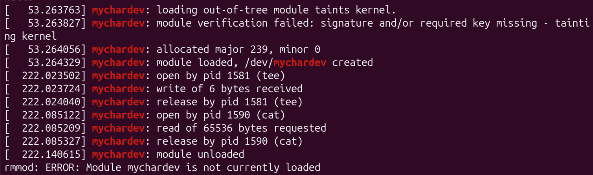

# Linux Driver Development Exploration


A loadable Linux kernel module that registers a **virtual character device**, plus a user-space C program that talks to it through system calls. The project explores how user programs reach the kernel, how data crosses the user/kernel boundary safely, and what a compiled kernel module looks like at the object-file and assembly level.

Built for CS 370 — Computer Systems and Architecture.

---

## What it does

**Working and tested (stage 3, midterm):**

- Builds as a loadable kernel module (`mychardev.ko`) against the running kernel's headers
- Registers a virtual character device (`/dev/mychardev`) when the module loads, and removes it on unload
- Implements `open`, `read`, `write`, and `close` (release) handlers that log each operation, including the calling process's pid and name, to the kernel log
- Tested by loading it in a QEMU/KVM virtual machine and driving it with `echo`, `tee`, and `cat`

**Stage 4 (code written, testing in progress):**

- Stores up to 1024 bytes in a fixed-size kernel buffer shared by every process that opens the device
- Moves data between user space and kernel space with `copy_from_user` and `copy_to_user`
- Protects the buffer with a mutex, so concurrent readers and writers cannot corrupt it or see half-written data
- Handles edge cases: an oversized write is shortened and then fails with `ENOSPC`, and a bad user pointer returns `EFAULT` instead of crashing the kernel
- User-space test program writes a string, reads it back, prints buffer addresses, and runs the edge-case and concurrency tests
- Two optional load parameters for testing: `use_lock=0` turns the mutex off, and `verbose=0` silences the per-operation log lines

**Analysis:** the module is examined with `readelf`, `nm`, `objdump`, `strace`, and lldb to connect the code to CS 370 concepts. Saved output is in `docs/evidence/`.

> **Scope:** Real hardware, interrupts, USB/PCI drivers, and device trees are out of scope. The goal is a small driver that I can fully explain.

---

## Status

- [x] Hello-world kernel module (stage 1)
- [x] Stage 1 analysis: build output, `modinfo`, `nm`, `readelf`, `objdump` (`docs/evidence/`)
- [x] Character device with `open`/`release`/`read`/`write` logging (stage 3), built on kernel 7.0 and loaded in the VM
- [x] Stage 3 analysis saved (`docs/evidence/stage3_*`)
- [ ] Kernel buffer with `copy_to_user` / `copy_from_user` (stage 4): code written, testing in progress
- [ ] Mutex around the buffer (added after midterm feedback): code written, testing in progress
- [ ] User-space test program that writes, reads back, and runs edge-case and race tests: code written, testing in progress
- [ ] Edge-case testing (empty buffer, oversized write, bad pointer)
- [ ] `strace` and lldb evidence

---

## Screenshots



*Stage 3 running: the module allocates major 239, minor 0 and creates `/dev/mychardev`. `tee` (pid 1581) and `cat` (pid 1590) trigger the open, write, read, and release handlers.*

---

## How it works

> **Current behavior (stage 4):** `write` copies data into a 1024-byte kernel buffer and `read` returns it, then 0 bytes (end of file). A mutex lets only one process use the buffer at a time. In stage 3 (the midterm build), `read` returned 0 and `write` discarded the data.

### Data flow

| User program     | Kernel                   | Driver module                                      |
| ---------------- | ------------------------ | -------------------------------------------------- |
| `open("/dev/X")` | syscall, then VFS lookup | open handler                                       |
| `write(fd, buf)` | syscall, then VFS        | write handler, `copy_from_user` into kernel buffer |
| `read(fd, buf)`  | syscall, then VFS        | read handler, `copy_to_user` into user buffer      |
| `close(fd)`      | syscall, then VFS        | release handler                                    |

*Stage 3 only logged these operations; stage 4 added the buffer and the `copy_*` calls.*

The kernel cannot trust a pointer handed to it by a user program, since user and kernel space are separate address spaces. `copy_from_user` and `copy_to_user` validate the user address and copy the data safely, which is the central idea of the driver.

### CS 370 concepts

| CS 370 concept                 | Where it shows up in this project                                                                                                    |
| ------------------------------ | ------------------------------------------------------------------------------------------------------------------------------------ |
| System calls                   | `tee` and `cat` reach the driver through `open`, `read`, `write`, and `close`                                                        |
| Registers                      | In `objdump`, the arguments to `alloc_chrdev_region` are set up in `rdi`, `esi`, `edx`, and `rcx`                                    |
| Number systems and bitwise ops | `MAJOR()`/`MINOR()` compile to `shr $0x14` and `and $0xfffff`; `crw-------` is octal 600; hex addresses in `nm`/`objdump`            |
| Assembly and control flow      | `if (ret < 0)` checks compile to `test` plus a conditional jump (`jns`), with a cleanup path on failure                              |
| Compilation and object files   | `make` builds a relocatable ELF `.ko`; `readelf` shows type `REL`, and `.rela.*` sections hold the relocations the loader patches    |
| Processes                      | `dmesg` lines name the pid and command that used the device (`tee`, `cat`)                                                           |
| User vs. kernel space          | Separate address spaces; `copy_to_user` / `copy_from_user` check user pointers and return `EFAULT` on a bad one                      |
| Concurrency and shared memory  | Several processes share one kernel buffer; a mutex keeps one process inside it at a time, so a read never sees a half-written buffer |
| Memory                         | Fixed-size buffer with bounds checks: short writes, then `ENOSPC` when full                                                          |
| The stack                      | Planned: stack frames in the test program with lldb                                                                                  |

*Note: `mychardev_init` shows up as `init_module` in `objdump` output, because both names refer to the same function.*

---

## Planned features

### Stretch goals (only if the core is finished)

- **`ioctl` command** — clear the buffer or report its size
- **Open counter** — track how many times the device has been opened
- **Kernel debugging setup** — attach a debugger to a kernel running in QEMU

---

## Project structure

```plaintext
.
├── module/
│   ├── mychardev.c            # Kernel module: registers device, implements file operations
│   └── Makefile               # Builds the module with the kernel's build system
├── user/
│   └── test_driver.c          # User-space test program (write/read back, edge cases, race test)
├── docs/
│   ├── screenshots/           # Terminal captures used in the report
│   ├── evidence/              # Saved readelf / nm / objdump / dmesg output
│   ├── notes/                 # Dev log
│   ├── proposal.md
│   ├── setup_guide.md
│   └── midterm_report.pdf
├── LICENSE
├── .gitignore
└── README.md
```

---

## Running locally

> **Warning:** Kernel modules run inside the real kernel. A bug can freeze or crash the machine. Load modules only inside a QEMU/KVM virtual machine, commit work to Git, and run `sync` before loading a new build. This project cannot run on macOS or in cloud environments such as Codespaces; it needs a Linux system with kernel headers matching the running kernel. See [docs/setup_guide.md](docs/setup_guide.md) for how the VM was set up.

**Prerequisites:** Ubuntu 26.04 LTS on x86-64 (native install or VM)

```bash
sudo apt update
sudo apt install build-essential linux-headers-$(uname -r) gdb lldb strace git
```

**1. Build the kernel module:**

```bash
cd module
make
```

This produces `mychardev.ko`. The build prints warnings about the compiler and `pahole` differing from the kernel's, and about skipping BTF generation; these come from the environment and are harmless.

**2. Load the module** (inside the VM):

```bash
sync
sudo insmod mychardev.ko
lsmod | grep mychardev
sudo dmesg | grep mychardev
ls -l /dev/mychardev
```

`insmod` prints nothing on success. `dmesg` needs `sudo` on Ubuntu. The log shows "loading out-of-tree module taints kernel" and "module verification failed" because the module is unsigned; this is expected for a self-built module. It then shows `allocated major N, minor 0` (N varies) and `module loaded, /dev/mychardev created`.

**3. Exercise the handlers:**

```bash
echo "hello" | sudo tee /dev/mychardev
sudo cat /dev/mychardev
sudo dmesg | grep mychardev
```

The log shows open, write (6 bytes stored), and release for `tee`, then open, read, and release for `cat`. `cat` prints `hello`, because stage 4 keeps the data in the kernel buffer and returns it on read. (In stage 3, `cat` printed nothing.)

**4. Build and run the test program:**

```bash
cd ../user
gcc -std=c99 -g -Wall -o test_driver test_driver.c
sudo ./test_driver empty   # run right after loading: read returns 0 (end of file)
sudo ./test_driver rw      # write a string, reopen, read it back
sudo ./test_driver big     # 2000 bytes into a 1024-byte buffer: short write, then ENOSPC
sudo ./test_driver fault   # bad pointer: the driver returns EFAULT
sudo ./test_driver race    # 2 writers and 2 readers; counts torn reads
```

The device node is owned by root (`crw-------`), so the program needs `sudo`.

**Mutex demo:** load with `sudo insmod mychardev.ko verbose=0` and run `race`; there should be 0 torn reads. Then unload, reload with `verbose=0 use_lock=0`, and run it again. Torn reads may appear, because readers can catch the buffer halfway through a write. This needs more than one CPU core, so it may not show up on every run.

**5. Unload the module:**

```bash
sudo rmmod mychardev
sudo dmesg | grep mychardev
```

The last line should read `module unloaded`.

**6. Clean up build files:**

```bash
cd module
make clean
```

---

## Analysis commands

Used to gather the technical evidence for the reports:

```bash
modinfo mychardev.ko
nm mychardev.ko
readelf -h -S mychardev.ko
objdump -d mychardev.ko
strace ./test_driver
lldb ./test_driver
```

---

## Testing

There is no automated test framework; testing is done by running the module and checking results manually. Results below are from the VM running Ubuntu 26.04.1 (kernel 7.0.0-38-generic). Rows marked Pass are stage 3 results; rows marked Pending are stage 4 and will be filled in after testing.

| Test                                          | Expected result                               | Result                                     |
| --------------------------------------------- | --------------------------------------------- | ------------------------------------------ |
| Build on kernel 7.0                           | `make` produces `mychardev.ko`                | Pass (environment warnings only)           |
| Load the module                               | Module loads, major number allocated          | Pass: major 239, minor 0                   |
| Device node appears                           | `/dev/mychardev` exists after `insmod`        | Pass: `crw------- root`, 239, 0            |
| Open and close the device                     | `open` and release messages appear in `dmesg` | Pass: lines name pid and command           |
| Write                                         | Write handler receives the bytes              | Pass: 6 bytes ("hello" plus newline)       |
| Read                                          | Read handler is called, returns 0 bytes       | Pass: `cat` requested 65536 bytes, got EOF |
| Unload the module                             | `module unloaded` is logged                   | Pass                                       |
| Write, then read back                         | Data read matches data written                | Pending (`test_driver rw`)                 |
| Read with nothing stored                      | Returns 0 (end of file)                       | Pending (`test_driver empty`)              |
| Write larger than the buffer                  | Short write of 1024 bytes, then `ENOSPC`      | Pending (`test_driver big`)                |
| Bad user pointer                              | `EFAULT`, no kernel crash                     | Pending (`test_driver fault`)              |
| Concurrent readers and writers, lock on       | 0 torn reads                                  | Pending (`test_driver race`)               |
| Concurrent readers and writers, `use_lock=0`  | Torn reads may appear                         | Pending                                    |
| Open the device when the module is not loaded | `open` fails with "No such file or directory" | Not yet                                    |

---

## Tech

- **Language:** C (kernel module uses the kernel's GNU C dialect; the test program uses C99)
- **Environment:** Ubuntu 26.04.1 LTS on a 2015 Intel MacBook (kernel 7.0.0-34-generic), with a QEMU/KVM Ubuntu 26.04.1 guest (kernel 7.0.0-38-generic) for loading the module
- **Build:** GNU Make with the kernel build system (module), gcc (test program)
- **Analysis:** `readelf`, `nm`, `objdump`, `modinfo`, `strace`, `lldb`, `GDB`
- **Version control:** Git/GitHub

---

## Documentation

| Document                                  | Description                                             |
| ----------------------------------------- | ------------------------------------------------------- |
| [Project Proposal](docs/proposal.md)      | Original proposal submitted for CS 370                  |
| [Midterm Report](docs/midterm_report.pdf) | Progress report with technical evidence                 |
| [Setup Guide](docs/setup_guide.md)        | How the development environment and test VM are set up  |
| [Dev Log](docs/notes/dev_log.md)          | Chronological record of decisions, bugs, and fixes      |
| [Evidence](docs/evidence/)                | Saved tool output (`readelf`, `objdump`, `nm`, `dmesg`) |

---

## License

GPL-2.0 — see [LICENSE](./LICENSE) for details.

The module source declares `MODULE_LICENSE("GPL")`, so the repository license matches what the kernel expects.